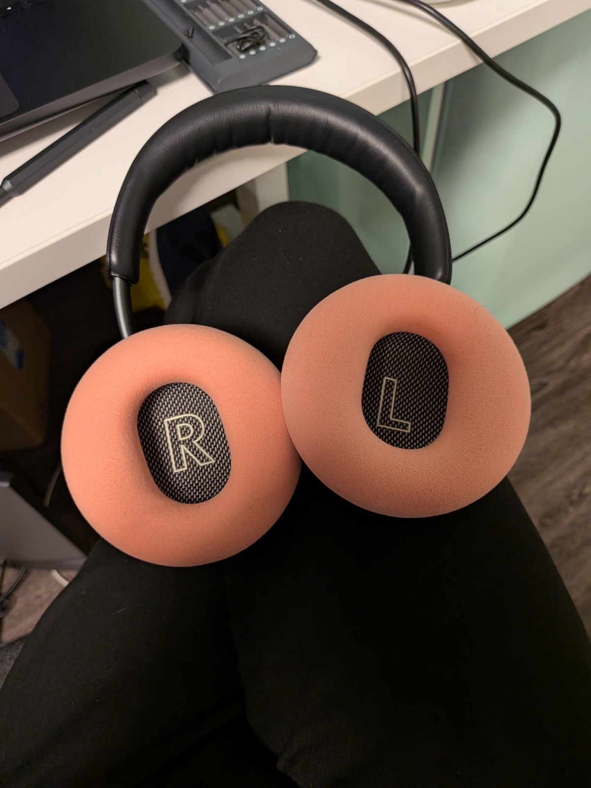

# Workshop

A hobby workshop kept as code: 3D-printed parts designed in Python, the notes on how one printer and its
materials actually behave, and the method that keeps a part from being built on a number nobody measured.
Most of the CAD and text is written by AI agents under the rules in [`AGENTS.md`](AGENTS.md).

Finished projects live in [`projects/`](projects/), each with its source, pictures and print settings.

| Picture | Project | What it is |
|---|---|---|
|  | [Dyson OnTrac cushions on Bose QuietComfort Ultra](projects/dyson-ontrac-bose-qc-ultra-adapter/) | A two-part printed adapter ring: Dyson's twist-lock ear cushions on Bose headphones |

## Find your way

| I want to… | Read |
|---|---|
| print one of the projects | its README under [`projects/`](projects/); STL and STEP files are on the [releases page](https://github.com/jfelding/workshop/releases) |
| print a part on the Neptune 3 Pro | [`equipment/neptune-3-pro/`](equipment/neptune-3-pro/) |
| size a hole, a nut pocket or a press fit | [`materials/fits.md`](materials/fits.md), `workshop.fits` |
| design a part in code | [`methods/cad-in-code.md`](methods/cad-in-code.md) |
| check fits and movement against the solid | [`methods/cad-in-code.md`](methods/cad-in-code.md#checking-a-part-against-the-solid-not-the-picture), `workshop.cad.checks` |
| write an assembly guide | [`methods/assembly-guides.md`](methods/assembly-guides.md) |
| run a project with AI agents | [`methods/agent-workflow.md`](methods/agent-workflow.md) |
| learn what went wrong before | [`methods/lessons.md`](methods/lessons.md) |
| start a new project | `tools/new-project.sh <name>`, then [`CONTRIBUTING.md`](CONTRIBUTING.md) |

## Layout

```
src/workshop/        the Python library (uv name: workshop)
  measure.py           mm(): refuse to build on an unmeasured dimension
  fits.py              measured fit allowances per machine × material × nozzle
  cad/                 geometry primitives, export, solid and STL checks, part pictures, guide-style renders
  guides/              assembly-guide page kit (style, electronics drawings, chapter book)
  tools/               file-size check, pictures check, log archiver
equipment/<machine>/ rules, facts, saved settings and drivers per machine
materials/           what each material does, and the fits table with its evidence
methods/             how the work is done: CAD in code, guides, agents, lessons
projects/<name>/     the projects (each a uv workspace member)
templates/project/   the skeleton for a new project
```

## Building a project

You need [uv](https://docs.astral.sh/uv/) (the Python package manager). Projects are workspace members and
use the library in this repo:

```sh
cd projects/dyson-ontrac-bose-qc-ultra-adapter
./check.sh          # rebuilds every part into exports/ (STL, STEP, PNG) and runs its checks
```

A project in its own repo can pin a released version of the library:

```toml
dependencies = ["workshop[cad] @ git+https://github.com/jfelding/workshop@v0.1.0"]
```

Extras: `cad` (build123d), `printer` (pyserial). Changes are listed in [`CHANGELOG.md`](CHANGELOG.md).

## Licence

- **Code** (`src/`, `tests/`, `tools/`, `equipment/`, `templates/` and the scripts in each project): MIT, see
  [`LICENSE`](LICENSE).
- **Project design files** (models, pictures, photos, documentation of a project): CC BY 4.0 unless the
  project's README says otherwise. A part that builds on someone else's model keeps that model's licence
  and credits its author.
