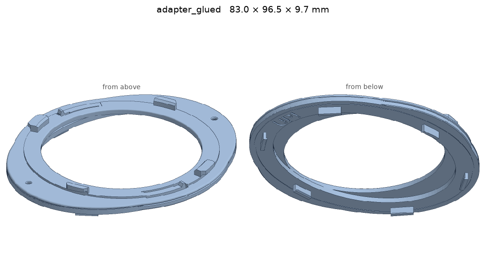

# Projects

## Here or in its own repo?

**Here** (`projects/<name>/`) when it is small: a fixture, a jig, an adapter, a one-off tool. Typical
signs are a handful of parts, one person, and days to weeks. You get the current library, CI and
the shop's knowledge next door. Create one with:

```sh
tools/new-project.sh my-fixture "Owner Name"
```

**Its own repo** when it has a life of its own: months of work, its own software or firmware,
its own issues, or data that does not belong next to everyone else's. Start from `templates/project/`
(copy it), pin `workshop@vX.Y.Z` in its `pyproject.toml`, and add a row below.

A project that outgrows this repo moves out with `git subtree split -P projects/<name>`, which keeps its
history. Leave a row behind.

## Index

| Picture | Project | Owner | Where | Status |
|---|---|---|---|---|
|  | [Dyson OnTrac cushions on Bose QuietComfort Ultra](dyson-ontrac-bose-qc-ultra-adapter/) | Jacob | here | v2 printed, in daily use |

## Rules for a project here

- Each project is a uv workspace member: `pyproject.toml` with `package = false`, depending on
  `workshop[...]` from the workspace.
- Generated files in `exports/` are git-ignored, except the pictures (`exports/*.png`), `exports/checks*.json`
  and the printable `exports/*.stl` and `exports/*.step`: commit those, so a reader sees the parts and can
  print them without running any code. G-code and 3MF are never committed (they belong to one printer and
  profile). A published project also attaches its STL and STEP files to its GitHub release.
- **Pictures.** The README opens with `exports/preview.png` (the whole thing) and has a parts table with each
  part's picture (`exports/<part>.png`, written by `workshop.cad.export`). Commit them. CI runs
  `ws-check-pictures --committed` on every project (no build needed) and fails if a part has no picture or the README does not
  show it.
- A `check.sh` in the project root runs its checks and ends with `uv run ws-check-pictures .`. Run it before
  committing; CI does not rebuild projects, to keep it cheap. It must exit non-zero on failure.
- Keep a `log/journal.md` once there is anything to remember: measurements, prints, outcomes.
