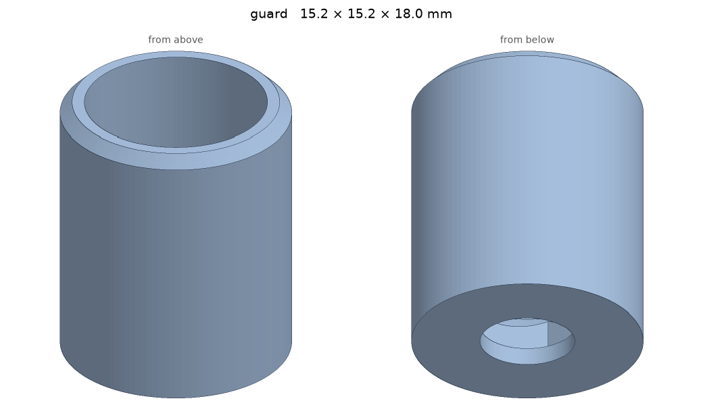
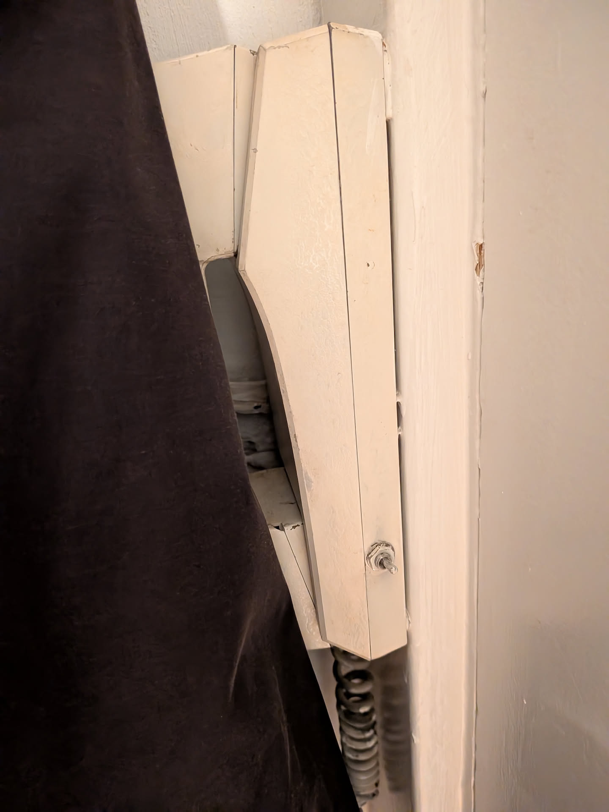

# Door phone mute switch guard

Owner: Jacob. Started 2026-11-19.



Our old door phone has a small toggle switch on the side of the handset that mutes the buzzer. Jackets hang
right beside it and flip it on their way past, and then nobody hears the door. This is a printed cup that goes
around the switch: the lever sits 3 mm below the rim, so cloth slides over it. A pen or a key still reaches in
when someone really wants to mute it.

**Status: designed and checked against the measurements, not yet printed.**



## Parts

| Picture | Part | File | How many | Notes |
|---|---|---|---|---|
|  | Guard cup | `exports/guard.stl` | 1 | Ø15.2 × 18 mm. Hex well for the switch's nut at the bottom, round bore for the lever above |

## How it goes on

1. Unscrew the switch's hex nut. Leave the washer where it is.
2. Drop the nut into the cup; it falls into a hex well at the bottom.
3. Put the cup over the switch and turn the whole cup clockwise by hand until it is snug. The cup is the
   wrench, so no tool is needed.

Nothing is glued or drilled, and it comes off the same way. The 1.2 mm floor under the nut uses up most of the
1.5 mm of thread that showed beyond the nut, so the nut ends up about flush with the end of the thread.

## Build

```sh
uv run python cad/guard.py     # writes exports/guard.{stl,step,png}, preview.png and checks.json
./check.sh                     # every check; run before committing
```

The script models the collar, the nut and the lever's whole swing as solids and fails if the cup touches any
of them, or if the nut runs out of thread.

## Printing

PLA, 0.4 mm nozzle, 0.2 mm layers, floor on the bed, no supports (nothing overhangs). Two fits, both from `workshop.fits`: the hole for the threaded collar
(`running`; if tight, twist a drill through it) and the hex well for the nut (`clearance`, 0.3 mm across flats).
