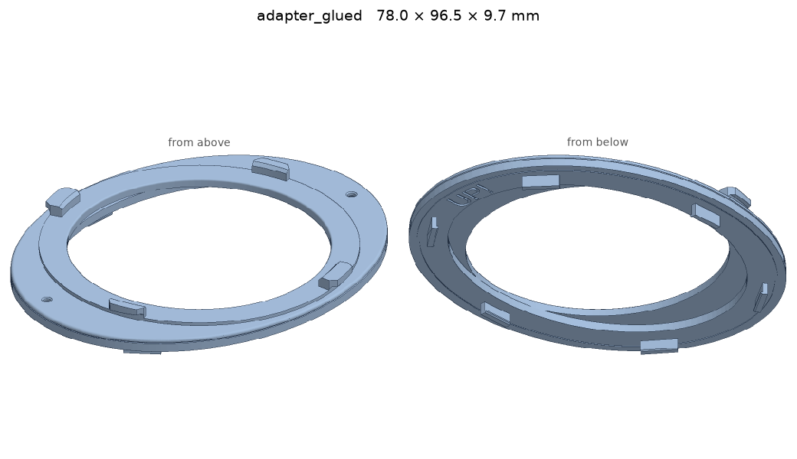
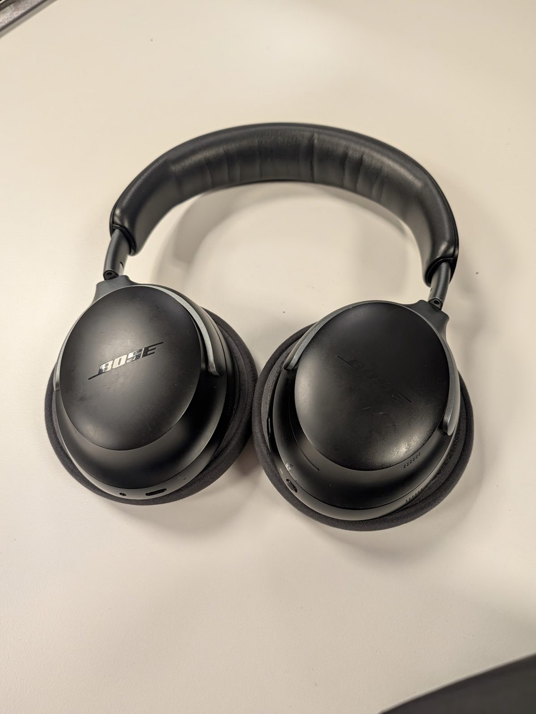
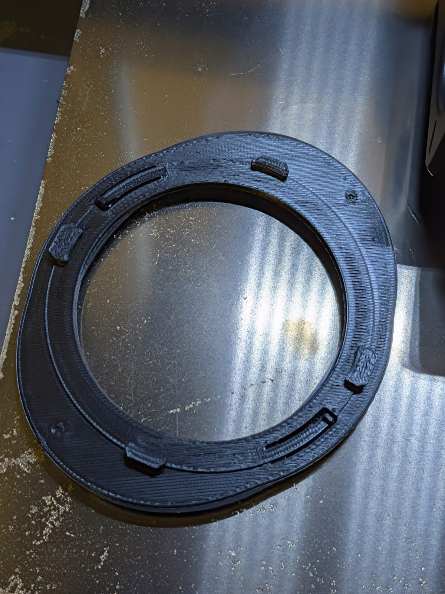
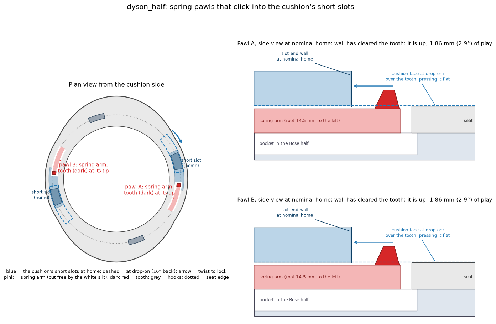

# Dyson OnTrac ear cushions on Bose QuietComfort Ultra headphones

My Bose QC Ultra (1st gen) headphones needed new earpads, and a local store was selling leftover Dyson
OnTrac earpads for 15 ¢. So I made an adapter and glued it onto a Bose earpad frame by Dr. Watt
(see [Credits](#credits-and-licence)).

It is two parts glued together rather than one, because it has hooks on both sides: clips for the Bose
earcup, and four twist-lock hooks for the Dyson cushion. The cushion twists on and clicks into place.
Nothing on the headphones or the cushions is modified.

| | | | |
|---|---|---|---|
|  |  |  |  |
| Both cushions fitted | The adapter is the thin seam between cushion and earcup | Adapter locked into a cushion, Bose side up | A glued adapter, Dyson side up: the slits round the spring arms are open |

## Parts

Print two of each. Left and right are identical. STL and STEP files are in [`exports/`](exports/) and on the
[latest release](https://github.com/jfelding/workshop/releases).

| Picture | Part | File | How many | Notes |
|---|---|---|---|---|
|  | Dyson half | `dyson_half.stl` / `.step` | 2 | 83.0 × 96.5 × 4.7 mm, 6.0 g. Twist-lock hooks and two spring latches |
|  | Bose half | `bose_half.stl` | 2 | 83.0 × 96.5 × 5.0 mm, 5.7 g. Dr. Watt's frame with pin pockets, a wider rim and two pockets for the latch arms |

Also needed: about 20 mm of 1.75 mm filament for four alignment pins, and superglue.

## Printing

Flat side down, no supports, no brim, about 27 minutes per part. I used Bambu Nebula PLA on an Elegoo
Neptune 3 Pro with the [`pla-fast-0.4`](../../equipment/neptune-3-pro/profiles/pla-fast-0.4/) profile:
0.4 mm nozzle, 0.2 mm layers, 210 °C nozzle, 60 °C bed. PETG lifted off the bed twice at this size.

The slits round the latch arms are 0.8 mm, two line widths. Check after the first layers that they stay open.

## Assembly

1. Push two 4 mm pieces of 1.75 mm filament into the pockets on the flat side of a Bose half.
2. Superglue a Dyson half onto it, flat side to flat side, with the pins through its holes. Use a thin film,
   on the flat rim only, and none within 3 mm of a latch pocket: glue that creeps into a slit freezes the arm.
   The pins and the flush edges line the halves up, and either way round is correct. Snip the pins flush.
3. Lay the cushion on the hooks where it drops flat and twist it clockwise by about 16° until it clicks.
4. Pull the original cushion off the earcup and press the adapter in until its clips snap.

To take a cushion off, twist it back firmly, like a jar lid.

## How it works

Each hook is a stem with a lip whose gap to the seat narrows from 1.4 mm to 0.8 mm along its length, so
twisting the cushion draws it down and clamps it. That alone holds by friction, so the cushion could creep
loose. The latch makes it click. Two strips of the plate are cut free on three sides by a 0.8 mm slit, which
turns each into a spring arm (a pawl) with a 1.2 mm tooth on its end:

- At drop-on the cushion's flat face presses both teeth down, flush with the seat (3.3 N each, calculated).
  The arms bend into the pockets in the Bose half.
- Near the end of the twist the closed end of each **short** slot in the cushion passes its tooth, and the
  tooth springs up into the slot. That is the click.
- Twisting back, the tooth's 65° face pushes the arm down again: about 0.67 N·m for both teeth, calculated.

The plate is wider than the Bose oval at the left and right (83 mm instead of 78 mm), so it covers the
cushion's hard back ring all round. Checks against the solid are in
[`exports/checks.json`](exports/checks.json): halves flush and not overlapping, pin paths clear, slits open,
the arm sweep clear of the Bose half both ways round, peak strain 1.4 % while a tooth is pressed flat (PLA
takes about 2 % before it creeps, so do not store a cushion half-twisted).

## Versions

- **v2.0.0, 2026-11-23.** Wider plate and spring latch. This is the one to print.
- v1.0.0, 2026-11-18. Narrow plate, friction only. **Do not print it.** It left the cushion's ring
  exposed at the sides and had no click, so the cushion could work loose.

Two test prints led from v1 to v2: a rigid detent bump (no click: the wedge leaves the cushion no room
to lift over anything) and a first latch with softer arms whose teeth were in the wrong place. The
journal in [`log/`](log/) has the details; the old parts are in git history.

## Changing the fit

Every dimension is in [`cad/measurements.py`](cad/measurements.py):

| If… | Change | Now |
|---|---|---|
| the cushion will not twist all the way | `LIP_GAP_TRAILING` up, 0.1 at a time | 0.8 |
| the cushion twists home but is loose | `LIP_GAP_TRAILING` down, 0.1 at a time | 0.8 |
| the hooks will not drop into the slots | `LIP_OUTER_RADIUS` down, or `STEM_INNER_RADIUS` up | 38.9; 34.4 / 36.0 |
| the cushion ends up rotated on the earcup | `CUSHION_CLOCKING_DEG` | 76 |
| no click at the end of the twist | `LATCH_FOOT_BEHIND_WALL_DEG`, both values down by 1 | −2.8, −2.8 |
| clicks, but the cushion turns back and forth too much | `LATCH_FOOT_BEHIND_WALL_DEG`, both values up by 0.5 | −2.8, −2.8 |
| too easy to twist off | `LATCH_LOCK_FACE_DEG` up, 2 at a time, 70 at most (steeper may never release) | 65 |
| too hard to twist off | `LATCH_LOCK_FACE_DEG` down, 3 at a time | 65 |
| an arm stays down or snaps | `LATCH_ARM_LENGTH_DEG` up (longer is softer) | 23 |
| the ring still shows at the sides, or the plate presses into the foam | `COVER_MARGIN` | 0.4 |
| the pins are loose or will not go in | `PIN_PRESS_POCKET`, `PIN_SLIP_HOLE` | 1.85, 1.95 |

## Build

Needs [uv](https://docs.astral.sh/uv/). `./check.sh` rebuilds both parts into `exports/`, runs the checks and
draws the pictures. The Dyson half is CAD in code ([build123d](https://build123d.readthedocs.io/)): the hooks
in `cad/hooks.py`, the plate and latch in `cad/dyson_half.py`. The Bose half is a mesh edit of the vendored
frame (`cad/bose_half.py`). Open questions are in [`inventory/to-measure.md`](inventory/to-measure.md).

## Credits and licence

- The Bose half is a remix of
  [Bose QuietComfort Ultra earpad frame](https://makerworld.com/en/models/529246-bose-quietcomfort-ultra-earpad-frame)
  by Dr. Watt, CC BY-NC-SA. I added two pin pockets, a wider rim at the sides and two latch pockets. So
  `bose_half.stl` is [CC BY-NC-SA 4.0](https://creativecommons.org/licenses/by-nc-sa/4.0/). The original is in
  [`vendor/bose-earpad-frame/`](vendor/bose-earpad-frame/).
- The Dyson half, pictures, photos and text are [CC BY 4.0](https://creativecommons.org/licenses/by/4.0/).
  The scripts are MIT. See [`LICENSE`](LICENSE).
- Not affiliated with Dyson or Bose.
