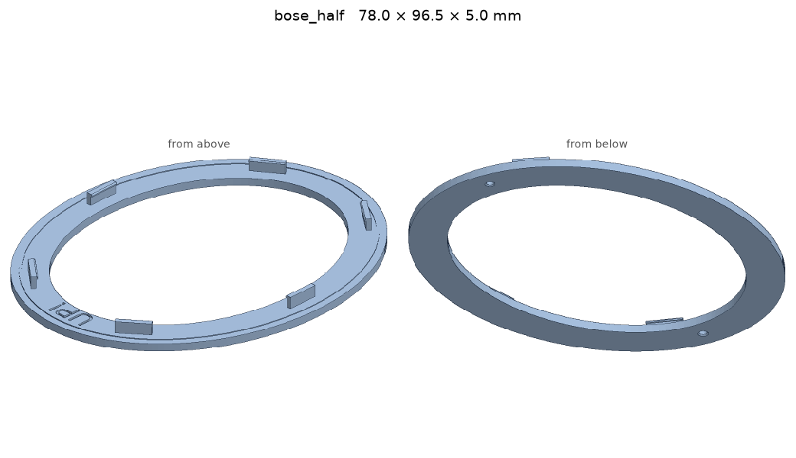

# Dyson OnTrac ear cushions on Bose QuietComfort Ultra headphones

Owner: Jacob. Printed and in daily use since 2026-11-17.


A printed adapter ring that puts the ear cushions of the Dyson OnTrac on Bose QuietComfort Ultra
Headphones (first generation). The Dyson cushions are large, soft and twist on and off; the Bose earcups
take a clip-in frame. The adapter is two flat prints glued back to back: one half clips into the Bose
earcup, the other has four hooks that the Dyson cushion twists onto. Nothing on the headphones or the
cushions is modified, and the original Bose cushions go back on at any time.

| | | |
|---|---|---|
|  |  |  |
| Both cushions fitted | The adapter is the thin dark seam between cushion and earcup | Dyson half locked into a cushion, glue side up, pins in place |

## Parts

Print **two of each** (one pair per ear). The left and right sides are identical.

| Picture | Part | File | How many | Notes |
|---|---|---|---|---|
|  | Dyson half | `dyson_half.stl` / `.step` | 2 | 78.0 × 96.5 × 4.7 mm, 5.9 g. Four wedge hooks for the cushion's twist lock |
|  | Bose half | `bose_half.stl` | 2 | 78.0 × 96.5 × 5.0 mm, 5.7 g. Clips into the earcup. A remix of Dr. Watt's earpad frame, see [Credits](#credits-and-licence) |

Also needed: about 20 mm of 1.75 mm filament (four alignment pins), and cyanoacrylate glue (superglue).

**Download:** the STL and STEP files are attached to the
[latest release](https://github.com/jfelding/workshop/releases). To build them yourself, see [Build](#build).

## Printing

| | |
|---|---|
| Material | PLA. PETG lifted off the bed twice at this size, and the PLA hooks have held up |
| Nozzle, layers | 0.4 mm nozzle, 0.2 mm layers |
| Orientation | Both parts flat side down, as the files come. No supports, no brim |
| Time | About 25 minutes per part on an Elegoo Neptune 3 Pro (PLA at 210 °C, bed 60 °C) |
| Profile used | [`pla-fast-0.4`](../../equipment/neptune-3-pro/profiles/pla-fast-0.4/) |

PLA softens at about 55 °C, so do not leave the headphones in a hot car.

## Assembly

1. Cut four pins of 1.75 mm filament, about 4 mm long.
2. Push two pins into the two small pockets on the **flat** side of a Bose half. They are a press fit.
3. Put a thin line of superglue around the flat side of the Bose half.
4. Lower a Dyson half onto it, flat side to flat side, with the pins going through its two holes. The pins
   and the flush outer edges line the halves up. Either way round is correct. Press for a minute.
5. Snip the pins flush on the hook side.
6. Fit the **cushion to the adapter first**: lay the cushion on the hooks, find the position where it drops
   flat, and twist it clockwise (seen from the hook side) by about 16° until it stops.
7. Pull the original cushion off the Bose earcup and press the adapter in until its clips snap.
   The oval hole in the cushion should now line up with the oval of the earcup.

To take it off, pull the adapter out of the earcup like a normal Bose cushion.

## How the lock works

The back of a Dyson cushion has four curved slots, two long and two short. A ledge closes over one end
of each slot. Each hook on the adapter is a short post with a lip pointing outward. The hooks drop into
the open part of the slots, and twisting slides each lip under its ledge.

The gap under each lip narrows from 1.4 mm at the end that enters first to 0.8 mm at the other. That
wedge pulls the cushion down onto the adapter as it turns and clamps it there, so there is no rattle and
no separate catch. The plate is 0.8 mm lower outside the hooks, because the ledges stand 0.6 mm proud of
the cushion and the plate would otherwise rest on them.

## Checks

`./check.sh` rebuilds the parts and checks the exported meshes ([`exports/checks.json`](exports/checks.json)):

- both parts are watertight single bodies sitting on the bed, and no layer starts in mid-air;
- glued together, the halves overlap by 0 mm³ and their outlines differ by 0.01 mm;
- a pin has a clear straight path through each Dyson hole into its Bose pocket (this catches a mirrored
  pocket, which cost one print);
- the cushion sits 4.0 mm further from the earcup than a Bose cushion's frame does.

## Changing the fit

Every dimension is in [`cad/measurements.py`](cad/measurements.py), marked as measured or tuned. The
ones worth knowing, if your printer or cushions differ:

| If… | Change | Now |
|---|---|---|
| the cushion will not twist all the way | `LIP_GAP_TRAILING` up, 0.1 at a time | 0.8 |
| the cushion twists home but is loose | `LIP_GAP_TRAILING` down, 0.1 at a time | 0.8 |
| the hooks will not drop into the slots | `LIP_OUTER_RADIUS` down, or `STEM_INNER_RADIUS` up | 38.9; 34.4 / 36.0 |
| the cushion ends up rotated on the earcup | `CUSHION_CLOCKING_DEG` | 76 |
| the pins are loose or will not go in | `PIN_PRESS_POCKET`, `PIN_SLIP_HOLE` | 1.85, 1.95 |

## Build

Needs [uv](https://docs.astral.sh/uv/). From this directory:

```sh
uv run python cad/dyson_half.py    # exports/dyson_half.{stl,step,png}
uv run python cad/bose_half.py     # exports/bose_half.{stl,png}
./check.sh                         # both, plus every check
```

The Dyson half is CAD in code ([build123d](https://build123d.readthedocs.io/)). The Bose half is a mesh
edit: the script cuts the two pin pockets into the vendored frame.

## Credits and licence

- The Bose half is a remix of **[Bose QuietComfort Ultra earpad frame](https://makerworld.com/en/models/529246-bose-quietcomfort-ultra-earpad-frame)**
  by **Dr. Watt** on MakerWorld, licensed CC BY-NC-SA. Change made: two pin pockets in the flat back. The
  original file is in [`vendor/bose-earpad-frame/`](vendor/bose-earpad-frame/).
- This project's design files (models, pictures, photos, this text) are licensed
  **[CC BY-NC-SA 4.0](https://creativecommons.org/licenses/by-nc-sa/4.0/)**: share and remix with credit,
  not for sale, under the same licence. See [`LICENSE`](LICENSE). The Python scripts are MIT, like the
  rest of the repo.
- Not affiliated with or endorsed by Dyson or Bose. Their names are used only to say what the part fits.
