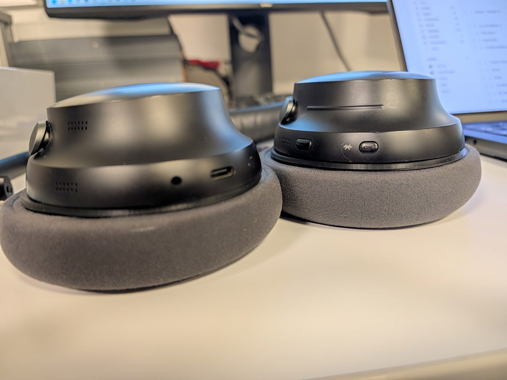
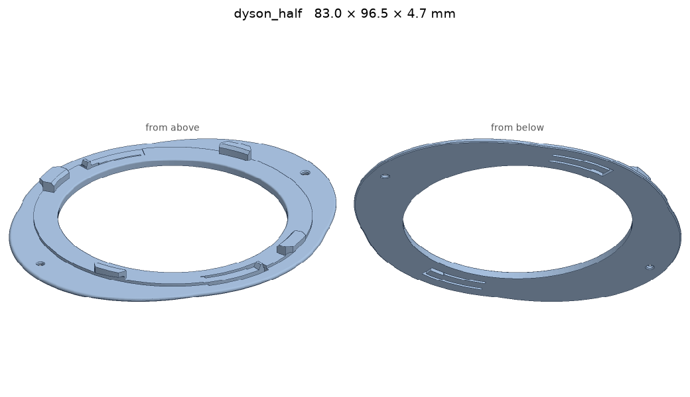
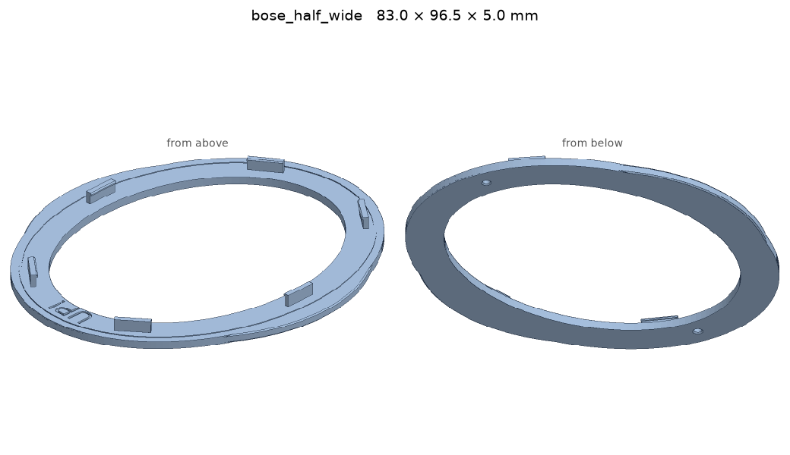
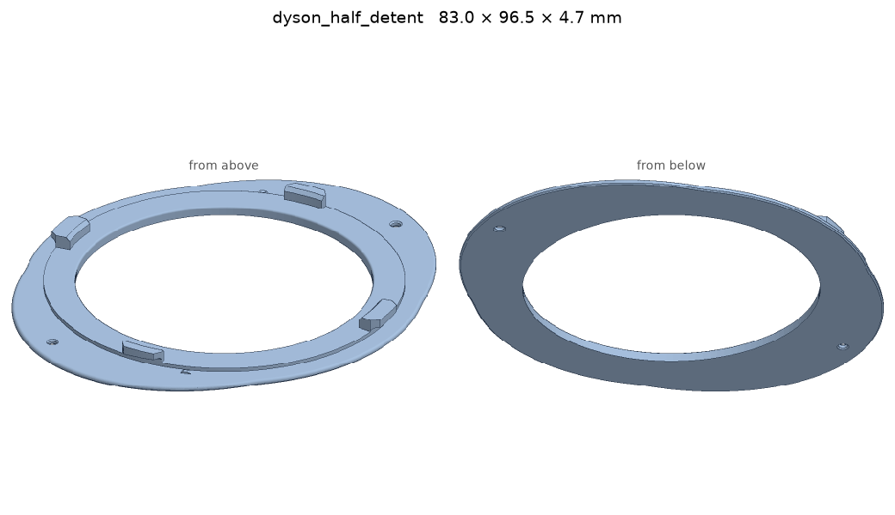
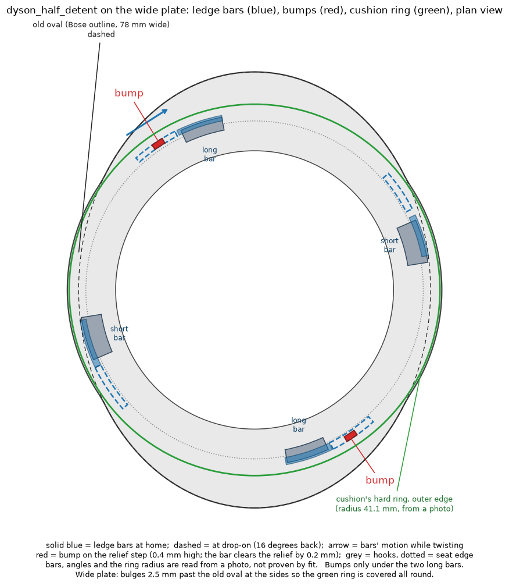
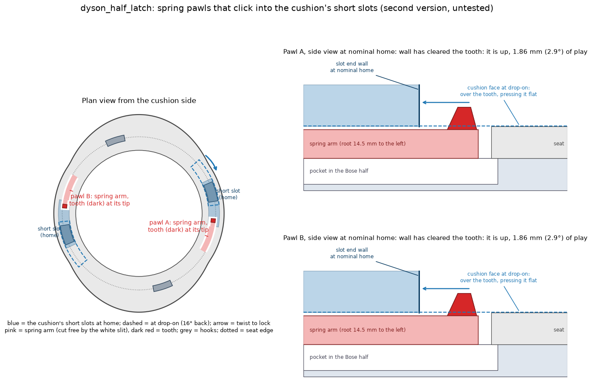

# Dyson OnTrac ear cushions on Bose QuietComfort Ultra headphones

My Bose QC Ultra (1st gen) headphones needed new earpads, and a local store was selling leftover Dyson
OnTrac earpads for 15 ¢. So I made an adapter and glued it onto a Bose earpad frame by Dr. Watt
(see [Credits](#credits-and-licence)).

It is two parts glued together rather than one, because it has hooks on both sides: clips for the Bose
earcup, and four twist-lock hooks for the Dyson cushion. Nothing on the headphones or the cushions is
modified. In daily use since 2026-11-17.

| | | |
|---|---|---|
|  |  |  |
| Both cushions fitted | The adapter is the thin dark seam between cushion and earcup | Dyson half locked into a cushion, glue side up, pins in place |

## Parts

Print two of each. Left and right are identical. STL and STEP files are attached to the
[latest release](https://github.com/jfelding/workshop/releases).

| Picture | Part | File | How many | Notes |
|---|---|---|---|---|
|  | Dyson half | `dyson_half.stl` / `.step` | 2 | 78.0 × 96.5 × 4.7 mm, 5.9 g |
|  | Bose half | `bose_half.stl` | 2 | 78.0 × 96.5 × 5.0 mm, 5.7 g. Dr. Watt's frame with two pin pockets added |
|  | Bose half, wide rim test variant (**not printed, not proven**) | `bose_half_wide.stl` | 0 | 83.0 × 96.5 × 5.0 mm. The Bose half plus a 2 mm rim at the sides, matching `dyson_half_wide`. Glue it to the wide Dyson halves only |
|  | Dyson half, wide outline test variant (**not printed, not proven**) | `dyson_half_wide.stl` / `.step` | 0 | 83.0 × 96.5 × 4.7 mm. Printed 2026-11-23, fits well. Same hooks and seat; bulges 2.5 mm past the oval at the sides to cover the cushion's hard ring |
|  | Wide Dyson half with click detent, test variant (**not printed, not proven**) | `dyson_half_detent.stl` / `.step` | 0 | The wide half plus two 0.4 mm bumps. See below |
|  | Wide Dyson half with spring latch, test variant (**second version not printed, not proven**) | `dyson_half_latch.stl` / `.step` | 0 | 83.0 × 96.5 × 4.7 mm, 6.0 g. The wide half plus two spring pawls that click into the cushion's short slots. See [Latch](#latch) |
|  | Bose half for the latch, test variant (**not printed, not proven**) | `bose_half_latch.stl` | 0 | 83.0 × 96.5 × 5.0 mm, 5.7 g. `bose_half_wide` plus two 1.6 mm pockets that give the pawls room to move. Glue it to `dyson_half_latch` only |

Also needed: about 20 mm of 1.75 mm filament for four alignment pins, and superglue.

## Wide and detent test variants (untested)

`dyson_half_wide` has the same hooks and seat but its outline is the Bose oval united with a circle 0.4 mm
larger than the cushion's hard ring (radius 41.1 mm, read from a photo), blended with a 40 mm fillet. It
overhangs the Bose half by at most 2.5 mm, over about 72° of arc at each side, so the cushion's ring is covered
all round. The Bose half's earcup at that height was judged from the photos only: nothing visible that the bulge
would hit, unverified; the owner has since checked the earcup by eye (2026-11-22) and there is room at the sides.
`dyson_half_detent` and `dyson_half_latch` are built on the wide plate.

Pairs: `dyson_half_wide` (or `dyson_half_detent`) glues to `bose_half_wide`, so the edge is flush all round
([picture](exports/preview_wide.png)); the published narrow `dyson_half` and `bose_half` still go together.
`bose_half_wide` adds a flat 2 mm rim outside the frame's oval (0.3 mm chamfers, the frame is untouched inside),
built from the same outline function and tunables as the wide Dyson half. Its fit on the earcup is unverified.

### Detent

The Dyson half holds by wedge friction only; the original earcup clicks. `dyson_half_detent` adds a low ramped
bump on the stepped-down plate under each of the two long ledge bars, so a bar rides up it and drops off about
6 degrees before the stop. It is built from ledge-bar positions read off a photo, not measured
([`inventory/to-measure.md`](inventory/to-measure.md)), and has not been printed. Expect to reprint.

The bars are about as long as the twist and the wedge lets the cushion lift only about 0.2 mm near home, so the
click is a few degrees short of home, not at it. Checks: [`exports/checks.json`](exports/checks.json), `detent_sweep`.

### Latch

The wide plate was printed on 2026-11-23: it fits well, and the 0.4 mm bumps of `dyson_half_detent` give no
lock. A rigid bump cannot do it, because the wedge leaves the cushion no room to lift over anything near home.
So the latch moves instead of the cushion. `dyson_half_latch` has two pawls (a pawl is a sprung tooth that lets
something pass one way and blocks it the other way). Each is a 15 mm strip of the plate cut free on three sides
by a 0.8 mm slit, with a 1.2 mm tooth on its free end:

- At drop-on the cushion's flat face lands on the teeth and presses both arms down, flush with the seat
  (3.3 N each, calculated).
- Near the end of the twist the closed end of each **short** slot passes its tooth, and the tooth springs up
  into the slot. That is the click.
- To take the cushion off, twist it back firmly. The tooth's steep face (65° from flat) pushes the arm down
  again. Calculated at 0.67 N·m for both teeth together, a firm jar lid. Nothing has to be pressed or pried.

A first version was printed on 2026-11-23 with softer arms, a 62° face and the teeth at two different places,
because where the cushion stops was not known. Only the earlier tooth came up, only when the cushion was twisted
hard, and it held weakly. So the cushion stops 1 to 2° before the calculated home position. Both teeth now come
up together 3.0° before it, the arms are 1.5 times stiffer and the face is steeper: about 3.3 times the holding
torque of the one tooth that worked. This version is not printed. The cushion can turn back about 1 to 2°
(1 mm at the rim) before the teeth catch it; `LATCH_FOOT_BEHIND_WALL_DEG` trims that.

The arm needs room to go down, so `bose_half_latch` has a 1.6 mm deep pocket under each arm
([glued pair](exports/preview_latch.png)). The pockets print as short bridges, no supports. Without the Bose
half the arms come out of the plate's back while the cushion goes on; that is the same movement.

Checked against the solid ([`exports/checks.json`](exports/checks.json), `latch`): slits open, teeth flat from
drop-on, up from 2.75° before home to the hard stop, pressed-down arm 0.25 mm clear of the pocket floor, nothing
cut out of the Bose clips, peak strain in the arm 1.4 % and only while a tooth is pressed flat (PLA takes about
2 % before it creeps or cracks, so do not store the cushion half-twisted). The forces assume a PLA stiffness of
2500 MPa and friction of 0.3; neither is measured. Unknowns are in
[`inventory/to-measure.md`](inventory/to-measure.md).

## Printing

Flat side down, no supports, no brim, about 25 minutes per part. I used Bambu Nebula PLA on an Elegoo
Neptune 3 Pro with the [`pla-fast-0.4`](../../equipment/neptune-3-pro/profiles/pla-fast-0.4/) profile:
0.4 mm nozzle, 0.2 mm layers, 210 °C nozzle, 60 °C bed. PETG lifted off the bed twice at this size.

## Assembly

1. Push two 4 mm pieces of 1.75 mm filament into the pockets on the flat side of a Bose half.
2. Superglue a Dyson half onto it, flat side to flat side, with the pins through its holes. The pins
   and the flush edges line the halves up, and either way round is correct. Snip the pins flush.
   Latch variant: glue only on the Bose half's flat rim, a thin film, and none within 3 mm of a pocket.
   Glue that creeps into a slit freezes the pawl. Either way round is still correct: both pockets fit both arms.
3. Lay the cushion on the hooks where it drops flat and twist it clockwise by about 16° until it stops.
4. Pull the original cushion off the earcup and press the adapter in until its clips snap.

## Known shortcomings

- The Dyson half is a little too narrow at the sides: it does not fully cover the cushion's lock ring
  at the left and right of each earpad. A reprint would be wider there; a wider test part
  (`dyson_half_wide`) exists but is untested, the published part is still the narrow one.
- The "UP!" on the Bose half comes from Dr. Watt's frame. The adapter fits either way round.

## Changing the fit

The gap under each hook's lip narrows from 1.4 mm to 0.8 mm, which clamps the cushion as it turns.
Every dimension is in [`cad/measurements.py`](cad/measurements.py):

| If… | Change | Now |
|---|---|---|
| the cushion will not twist all the way | `LIP_GAP_TRAILING` up, 0.1 at a time | 0.8 |
| the cushion twists home but is loose | `LIP_GAP_TRAILING` down, 0.1 at a time | 0.8 |
| the hooks will not drop into the slots | `LIP_OUTER_RADIUS` down, or `STEM_INNER_RADIUS` up | 38.9; 34.4 / 36.0 |
| the cushion ends up rotated on the earcup | `CUSHION_CLOCKING_DEG` | 76 |
| detent: cushion will not twist home past the bump (test variant) | `BUMP_HEIGHT` 0.4 to 0.2, or `CREST_BEFORE_HOME_DEG` up | 0.4; 7 |
| detent: no click felt | `BUMP_HEIGHT` 0.4 to 0.6 | 0.4 |
| detent: too easy to twist back off | `BUMP_RELEASE_DEG` up (steeper holds more) | 35 |
| detent: the bump misses the bar | `BUMP_INNER_RADIUS`, `BUMP_OUTER_RADIUS`; `LEDGE_BARS_PHOTO` angles once measured | 38.2, 39.0 |
| latch: no click at the end of the twist | `LATCH_FOOT_BEHIND_WALL_DEG`, both values down by 1 (tooth further into the slot) | −2.8, −2.8 |
| latch: clicks, but the cushion turns back and forth too much | `LATCH_FOOT_BEHIND_WALL_DEG`, both values up by 0.5 at a time | −2.8, −2.8 |
| latch: too easy to twist off | `LATCH_LOCK_FACE_DEG` up, 2 at a time, 70 at most (steeper may never release) | 65 |
| latch: too hard to twist off | `LATCH_LOCK_FACE_DEG` down, 3 at a time | 65 |
| latch: an arm stays down or snaps | `LATCH_ARM_LENGTH_DEG` up (longer is softer) | 23 |
| latch: tooth rubs the slot's sides | `LATCH_TOOTH_INNER_RADIUS`, `LATCH_ARM_OUTER_RADIUS` | 35.3, 37.4 |
| wide plate: the ring still shows at the sides, or the plate presses into the foam | `COVER_MARGIN` (up or down) | 0.4 |
| wide plate: outline looks lumpy or fails to build | `OUTLINE_BLEND_RADIUS` | 40 |
| wide plate: the ring radius turns out different | `RING_OUTER_RADIUS` (measure it) | 41.1 |
| the pins are loose or will not go in | `PIN_PRESS_POCKET`, `PIN_SLIP_HOLE` | 1.85, 1.95 |

## Build

Needs [uv](https://docs.astral.sh/uv/). `./check.sh` rebuilds both parts into `exports/` and checks the
meshes (results in [`exports/checks.json`](exports/checks.json)). The Dyson half is CAD in code
([build123d](https://build123d.readthedocs.io/)); the Bose half is a mesh edit of the vendored frame.

## Credits and licence

- The Bose half is a remix of
  [Bose QuietComfort Ultra earpad frame](https://makerworld.com/en/models/529246-bose-quietcomfort-ultra-earpad-frame)
  by Dr. Watt, CC BY-NC-SA. I added two pin pockets (and, in the untested `bose_half_wide.stl` and `bose_half_latch.stl`, a wider rim at the sides and two pawl pockets). So `bose_half.stl`, `bose_half_wide.stl` and `bose_half_latch.stl` are
  [CC BY-NC-SA 4.0](https://creativecommons.org/licenses/by-nc-sa/4.0/). The original is in
  [`vendor/bose-earpad-frame/`](vendor/bose-earpad-frame/).
- The Dyson half, pictures, photos and text are [CC BY 4.0](https://creativecommons.org/licenses/by/4.0/).
  The scripts are MIT. See [`LICENSE`](LICENSE).
- Not affiliated with Dyson or Bose.
