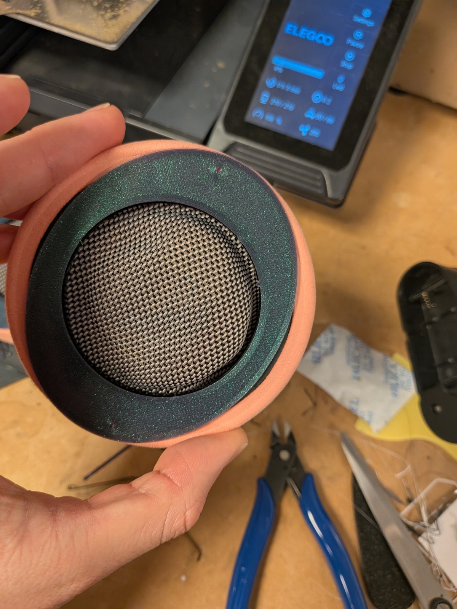

# Dyson OnTrac ear cushions on Bose QuietComfort Ultra headphones

My Bose QC Ultra (1st gen) headphones needed new earpads, and a local store was selling leftover Dyson
OnTrac earpads for 15 ¢. So I made an adapter and glued it onto a Bose earpad frame by Dr. Watt
(see [Credits](#credits-and-licence)).

It is two parts glued together rather than one, because it has hooks on both sides: clips for the Bose
earcup, and four twist-lock hooks for the Dyson cushion. Nothing on the headphones or the cushions is
modified. In daily use since 2026-11-17.

| | | |
|---|---|---|
|  |  |  |
| Both cushions fitted | The adapter is the thin dark seam between cushion and earcup | Dyson half locked into a cushion, glue side up, pins in place |

## Parts

Print two of each. Left and right are identical. STL and STEP files are attached to the
[latest release](https://github.com/jfelding/workshop/releases).

| Picture | Part | File | How many | Notes |
|---|---|---|---|---|
|  | Dyson half | `dyson_half.stl` / `.step` | 2 | 78.0 × 96.5 × 4.7 mm, 5.9 g |
|  | Bose half | `bose_half.stl` | 2 | 78.0 × 96.5 × 5.0 mm, 5.7 g. Dr. Watt's frame with two pin pockets added |

Also needed: about 20 mm of 1.75 mm filament for four alignment pins, and superglue.

## Printing

Flat side down, no supports, no brim, about 25 minutes per part. I used Bambu Nebula PLA on an Elegoo
Neptune 3 Pro with the [`pla-fast-0.4`](../../equipment/neptune-3-pro/profiles/pla-fast-0.4/) profile:
0.4 mm nozzle, 0.2 mm layers, 210 °C nozzle, 60 °C bed. PETG lifted off the bed twice at this size.

## Assembly

1. Push two 4 mm pieces of 1.75 mm filament into the pockets on the flat side of a Bose half.
2. Superglue a Dyson half onto it, flat side to flat side, with the pins through its holes. The pins
   and the flush edges line the halves up, and either way round is correct. Snip the pins flush.
3. Lay the cushion on the hooks where it drops flat and twist it clockwise by about 16° until it stops.
4. Pull the original cushion off the earcup and press the adapter in until its clips snap.

## Known shortcomings

- The Dyson half is a little too narrow at the sides: it does not fully cover the cushion's lock ring
  at the left and right of each earpad. A reprint would be wider there.
- The "UP!" on the Bose half comes from Dr. Watt's frame. The adapter fits either way round.

## Changing the fit

The gap under each hook's lip narrows from 1.4 mm to 0.8 mm, which clamps the cushion as it turns.
Every dimension is in [`cad/measurements.py`](cad/measurements.py):

| If… | Change | Now |
|---|---|---|
| the cushion will not twist all the way | `LIP_GAP_TRAILING` up, 0.1 at a time | 0.8 |
| the cushion twists home but is loose | `LIP_GAP_TRAILING` down, 0.1 at a time | 0.8 |
| the hooks will not drop into the slots | `LIP_OUTER_RADIUS` down, or `STEM_INNER_RADIUS` up | 38.9; 34.4 / 36.0 |
| the cushion ends up rotated on the earcup | `CUSHION_CLOCKING_DEG` | 76 |
| the pins are loose or will not go in | `PIN_PRESS_POCKET`, `PIN_SLIP_HOLE` | 1.85, 1.95 |

## Build

Needs [uv](https://docs.astral.sh/uv/). `./check.sh` rebuilds both parts into `exports/` and checks the
meshes (results in [`exports/checks.json`](exports/checks.json)). The Dyson half is CAD in code
([build123d](https://build123d.readthedocs.io/)); the Bose half is a mesh edit of the vendored frame.

## Credits and licence

- The Bose half is a remix of
  [Bose QuietComfort Ultra earpad frame](https://makerworld.com/en/models/529246-bose-quietcomfort-ultra-earpad-frame)
  by Dr. Watt, CC BY-NC-SA. I added two pin pockets. So `bose_half.stl` is
  [CC BY-NC-SA 4.0](https://creativecommons.org/licenses/by-nc-sa/4.0/). The original is in
  [`vendor/bose-earpad-frame/`](vendor/bose-earpad-frame/).
- The Dyson half, pictures, photos and text are [CC BY 4.0](https://creativecommons.org/licenses/by/4.0/).
  The scripts are MIT. See [`LICENSE`](LICENSE).
- Not affiliated with Dyson or Bose.
