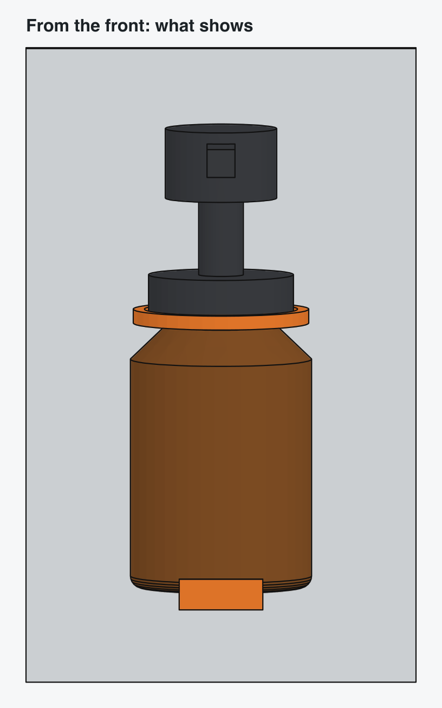
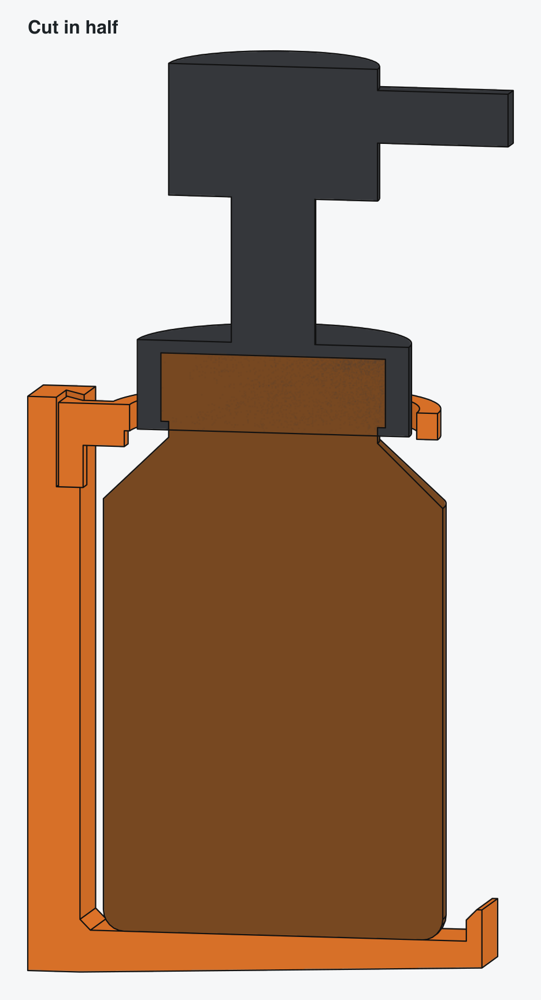
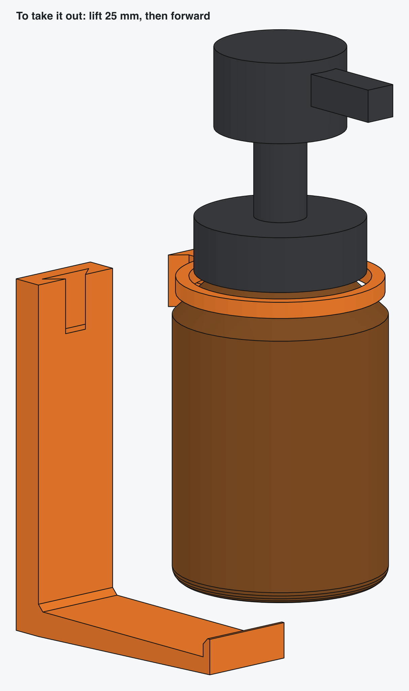
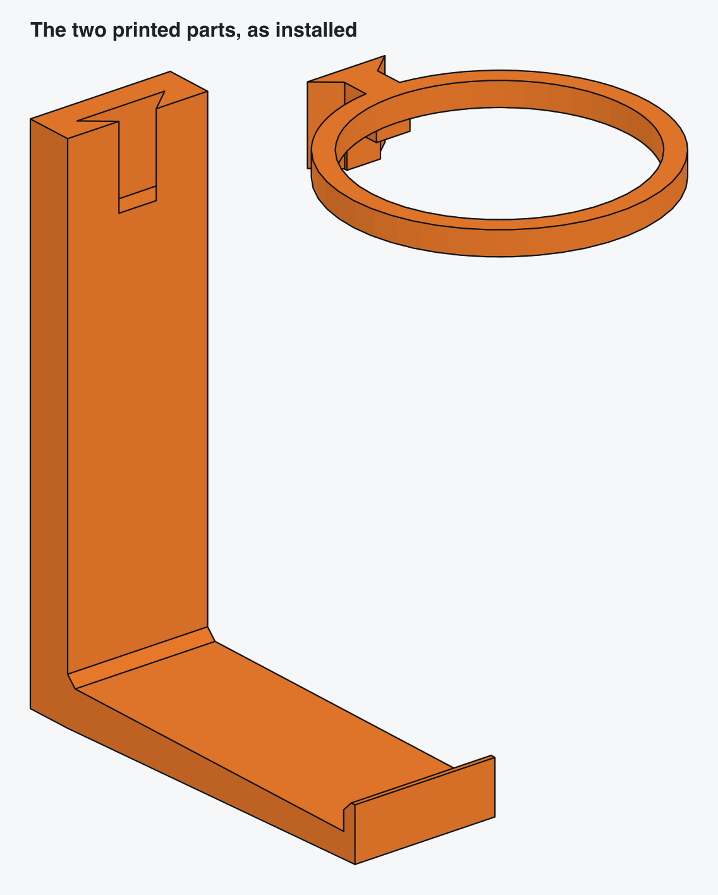
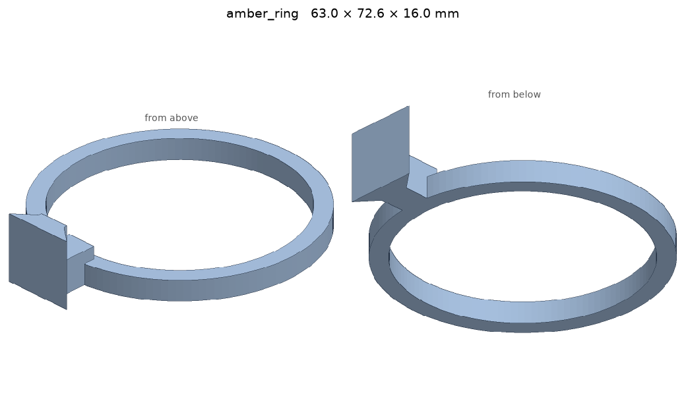
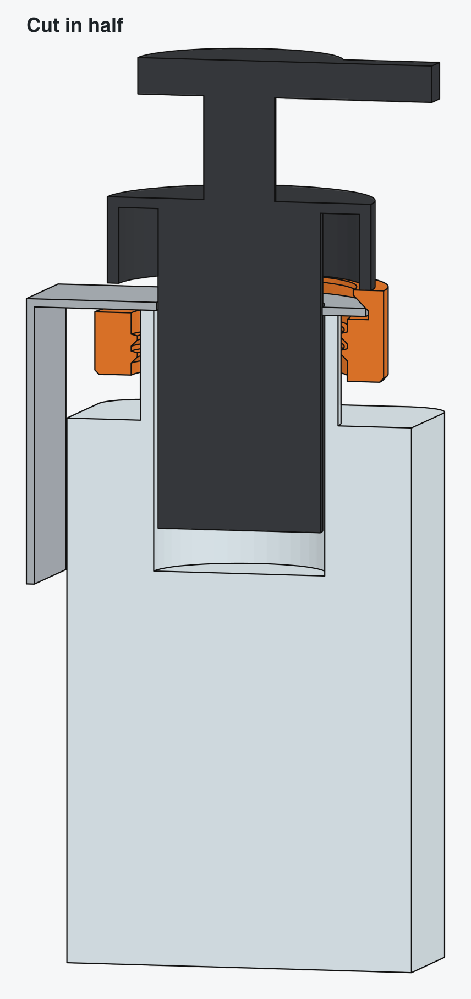

# foam-pump-bottle-adapter

Owner: Jacob Felding. Started 2026-11-19. **Stage: amber holder modelled from estimated dimensions, untested.**


The orange parts are designed. The bottle and pump in the pictures are a stand-in built from estimates
(seller figures and the pump's measured collar), not from the real bottle.

A wall bracket holds a soap bottle by its neck, and the foaming pump Jacob likes does not fit any bottle that
fits the bracket. The current answer: put the pump on its own amber glass bottle and give that bottle its own
printed holder (concept 7 in [`concepts.md`](concepts.md)). The glass stands on a foot; a ring round the pump
collar keys into the spine, so the bottle cannot come out forward. To take it out, lift it about 25 mm and pull
it towards you.

| | | |
|---|---|---|
|  |  |  |
|  |  | |

Every bottle dimension is an estimate (`EST_*` in [`cad/measurements.py`](cad/measurements.py), each with its
source and range). The holder is checked against bodies 62 to 68 mm wide and 107 to 113 mm tall. What to look
at after the first print: [`inventory/to-measure.md`](inventory/to-measure.md).

## Parts

| Picture | Part | File | How many | Notes |
|---|---|---|---|---|
|  | Amber holder: spine, foot, lip | `exports/amber_holder.stl` | 1 | print lying on its side as exported, PLA, no supports. 109 × 87 × 30 mm |
|  | Ring with key | `exports/amber_ring.stl` | 1 | print upside down as exported, key standing up. Goes round the pump collar's base. 63 mm across |
|  | Hanging collar, draft (fallback) | `exports/hanging_collar_draft.stl` | 0 | concept 6: pump C on the clear bottle in the old metal bracket. Pictures below |
|  | Stepped gauge for the black pump's collar | `exports/pump_c_gauge.stl` | 0 | optional: six steps, 43.2 to 45.2 mm |

## Putting it up

- No screws: glue the spine's flat back to the wall with construction adhesive (montagelim). Clean and
  degrease the wall; on paint, the paint is the weak link, so glue to tile or bare wall where you can. Let it
  cure fully (see the tube, usually a day) before the bottle goes in. The holder is sized for 6 N of bottle plus
  a 30 N push and a 20 N knock with a safety factor of at least 3 (`cad/amber_strength.py`); the glue line
  then sees under 0.1 MPa.
- Ring over the pump head (or over the neck with the pump off), key to the back. Lower the bottle so the key
  drops into the channel at the top of the spine; the glass lands on the foot behind the lip.

## The fallback: hanging collar on the old bracket

| | | |
|---|---|---|
|  |  |  |
|  |  |  |

Concept 6: a threaded collar on the old bracket's ring for pump C on the clear square bottle. Draft: one
bracket dimension is assumed, and the thread is untested.

## Build

```sh
uv run python cad/amber_holder.py          # exports/amber_holder.* and amber_ring.* (STL, STEP, picture)
uv run python cad/amber_checks.py          # checks against the stand-in bottle; exports/checks-amber.json
uv run python cad/amber_strength.py        # beam hand-calcs, safety factor 3 or more; exports/checks-amber-strength.json
uv run python cad/amber_illustrate.py      # runs the checks, writes exports/preview.png and amber-*.png
uv run python cad/hanging_collar.py --draft
uv run python cad/illustrate.py --draft    # the collar's view-*.png
uv run python cad/pump_c_gauge.py
python3 concepts/sketch.py concepts /tmp   # redraws the concept sketches
./check.sh
```
