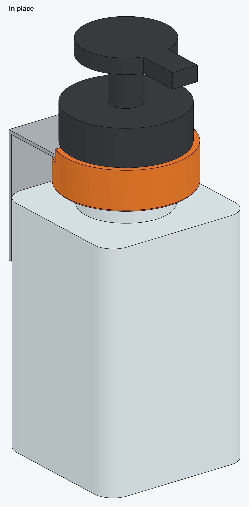
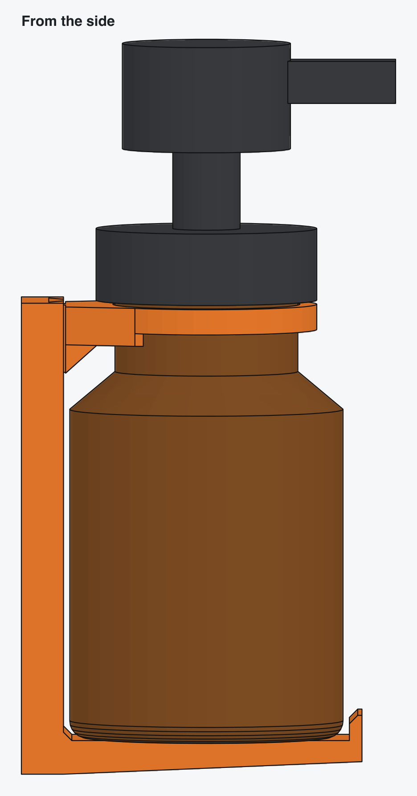
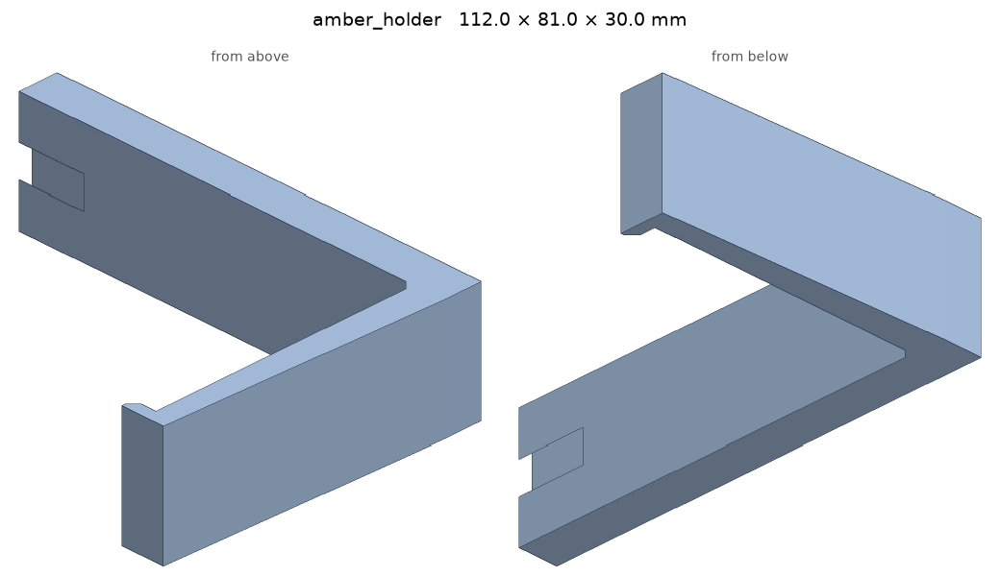
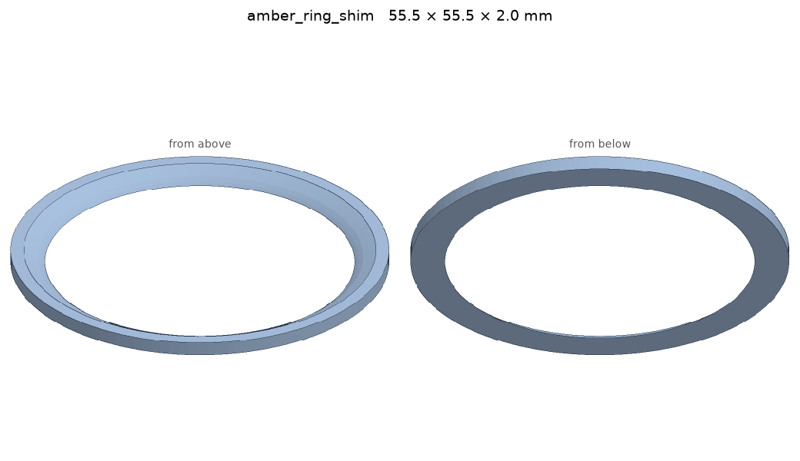
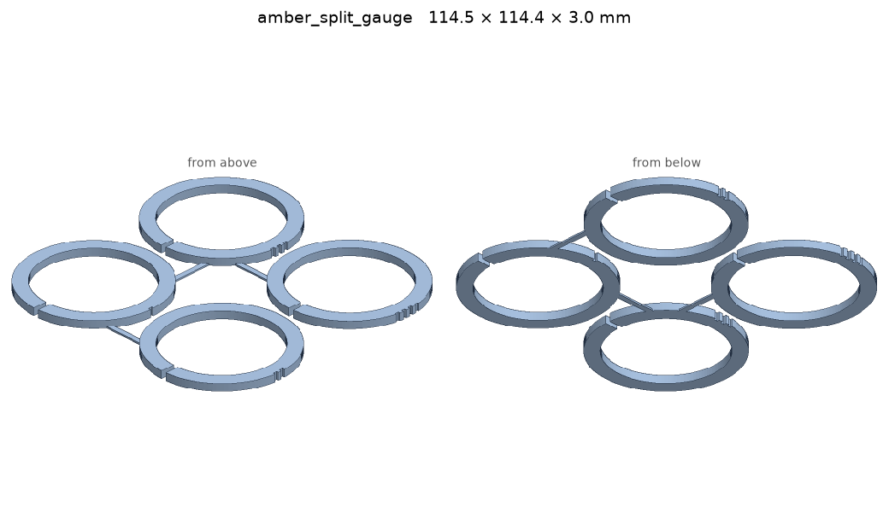
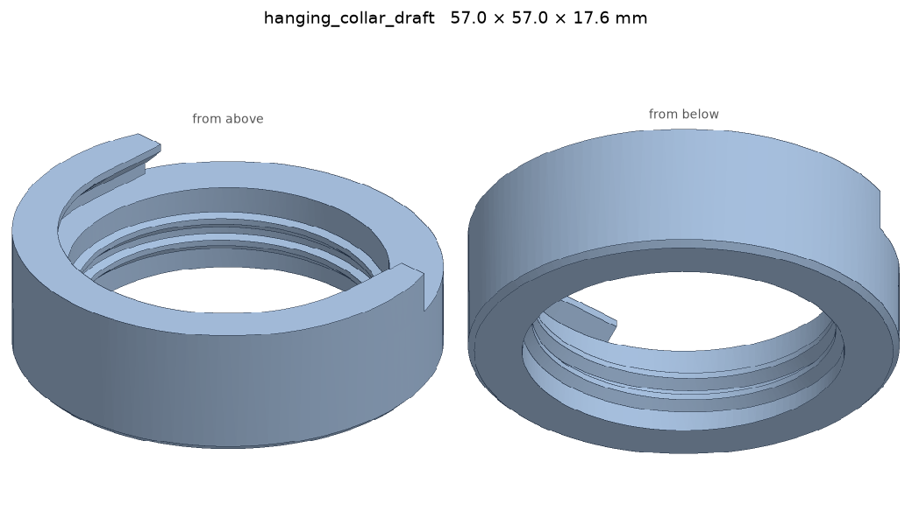
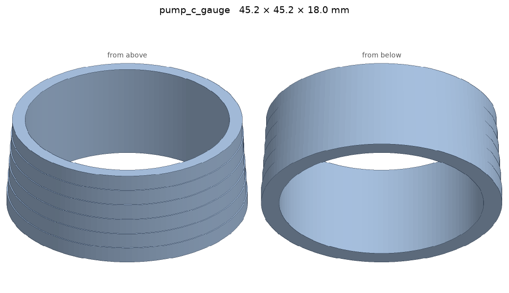
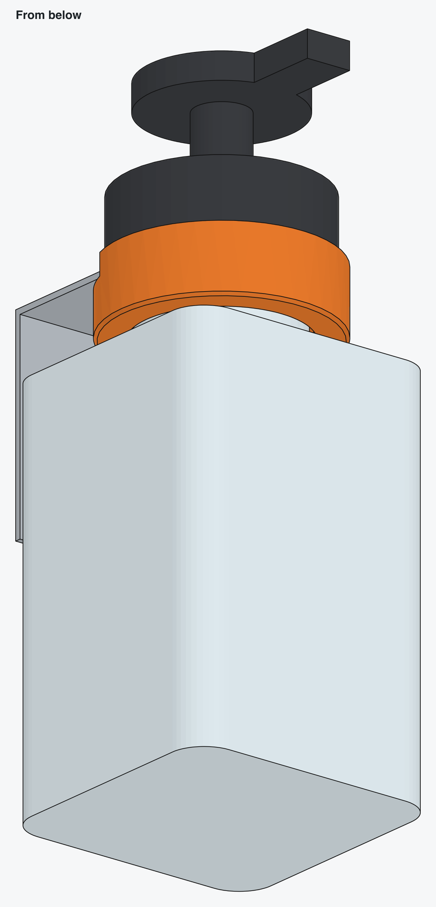
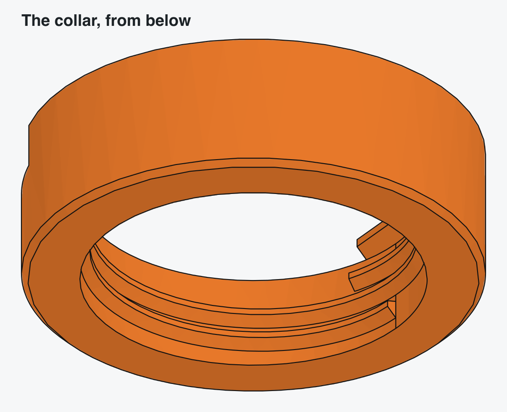

# foam-pump-bottle-adapter

Owner: Jacob Felding. Started 2026-11-19. **Stage: amber holder v2, from measurements of the real bottle, not yet printed.**



The orange parts are designed. The bottle and pump in the pictures are a stand-in built from the measured
bottle; only the shoulder's start and the pump head are estimates.

A wall bracket holds a soap bottle by its neck, and the foaming pump Jacob likes does not fit any bottle that
fits the bracket. The current answer: put the pump on its own amber glass bottle and give that bottle its own
printed holder (concept 7 in [`concepts.md`](concepts.md)). The glass stands on a foot; a ring on the bare neck,
trapped under the screwed-on pump collar, keys into the spine, so the bottle cannot come out forward. To take it
out, lift it about 20 mm and pull it towards you.

| | | |
|---|---|---|
|  |  |  |
|  |  | |

The first print, from seller estimates, was far too roomy and put the ring round the neck instead of the collar.
Version 2 uses the measured bottle (body 65, collar underside 104 mm up, neck 43.5, thread 44.0, 17 mm of bare
neck; [`cad/measurements.py`](cad/measurements.py)): 1.5 mm of air round the glass, and the ring sits on the
neck under the collar. What to check after printing: [`inventory/to-measure.md`](inventory/to-measure.md).

## Parts

| Picture | Part | File | How many | Notes |
|---|---|---|---|---|
|  | Amber holder: spine, foot, lip | `exports/amber_holder.stl` | 1 | print lying on its side as exported, PLA, no supports. 112 × 81 × 30 mm |
|  | Ring with key | `exports/amber_ring.stl` | 1 | print upside down as exported, key standing up, **100% infill**. Goes on the bare neck under the pump collar (pump off to fit it). 55.5 mm across, 6.5 tall; its bore follows the glass shoulder. The key has 0.15 mm play per side and is 0.5 mm long: it slides in without filing |
|  | Shim under the printed v4 ring | `exports/amber_ring_shim.stl` | 0 or 1 | only if you have the 4.5 mm tall v4 ring: slide it on the neck first (flat face up), then the ring. 2 mm tall, 55.5 across; it fills the gap to the shoulder, so v4 + shim = v5. Print flat face down, 100% infill |
|  | Split-ring bore gauge | `exports/amber_split_gauge.stl` | 0 or 1 | four slotted rings, bores 43.2 / 43.4 / 43.6 / 43.8 (notches count 1-4). Snap off the ties; pump off, push each over the thread onto the neck. The smallest that goes on by hand and sits snug sets the next ring's bore |
|  | Hanging collar, draft (fallback) | `exports/hanging_collar_draft.stl` | 0 | concept 6: pump C on the clear bottle in the old metal bracket. Pictures below |
|  | Stepped gauge for the black pump's collar | `exports/pump_c_gauge.stl` | 0 | optional: six steps, 43.2 to 45.2 mm |

## Putting it up

- No screws: glue the spine's flat back to the wall with construction adhesive (montagelim). Clean and
  degrease the wall; on paint, the paint is the weak link, so glue to tile or bare wall where you can. Let it
  cure fully (see the tube, usually a day) before the bottle goes in. The holder is sized for 6 N of bottle plus
  a 30 N push and a 20 N knock with a safety factor of at least 3 (`cad/amber_strength.py`); the glue line
  then sees under 0.1 MPa.
- **Caution on material:** printed in PLA, this holds a full bottle all day. PLA creeps (slowly sags under steady
  load), and softens from about 55-60 C, so over months or years it can fail, sooner in a warm spot such as sun
  or above a radiator. PETG is the safer choice for a long life; PLA is fine for a test or a short one. The
  strength numbers assume PLA and are hand calculations, not a test.
- Pump off, ring over the glass thread down onto the neck, pump back on: the collar keeps the ring on. Key to the back. Lower the bottle so the key
  drops into the channel at the top of the spine; the glass lands on the foot behind the lip.

## The fallback: hanging collar on the old bracket

| | | |
|---|---|---|
|  |  |  |
|  |  |  |

Concept 6: a threaded collar on the old bracket's ring for pump C on the clear square bottle. Draft: one
bracket dimension is assumed, and the thread is untested.

## Build

```sh
uv run python cad/amber_holder.py          # exports/amber_holder.* and amber_ring.* (STL, STEP, picture)
uv run python cad/amber_checks.py          # checks against the stand-in bottle; exports/checks-amber.json
uv run python cad/amber_strength.py        # beam hand-calcs, safety factor 3 or more; exports/checks-amber-strength.json
uv run python cad/amber_illustrate.py      # runs the checks, writes exports/preview.png and amber-*.png
uv run python cad/hanging_collar.py --draft
uv run python cad/illustrate.py --draft    # the collar's view-*.png
uv run python cad/pump_c_gauge.py
python3 concepts/sketch.py concepts /tmp   # redraws the concept sketches
./check.sh
```
