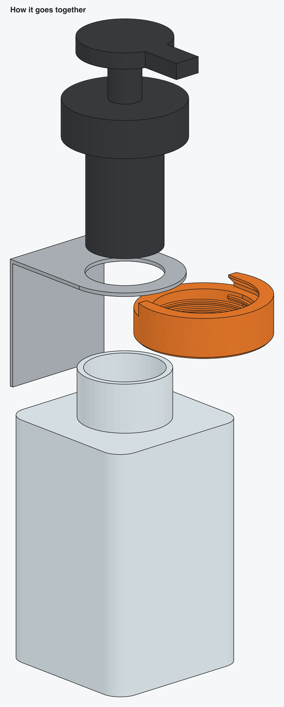
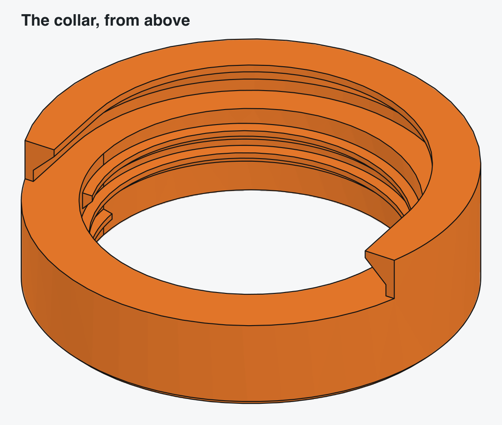
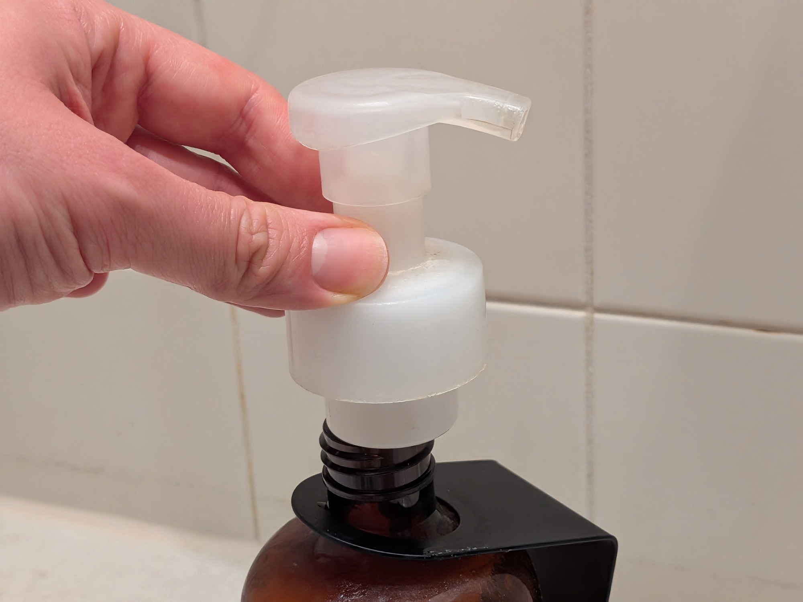

# foam-pump-bottle-adapter

Owner: Jacob Felding. Started 2026-11-19. **Stage: ideas, nothing measured or modelled yet.**


Only the orange collar is a designed part. The bottle body, the pump head and the bracket's distance from
the wall are drawn for context and are not measured.

| | | |
|---|---|---|
|  |  |  |
|  |  |  |

A wall bracket holds a soap bottle by its neck: the neck comes up through a hole in a metal ring and the
pump's screw collar sits on top, so the bottle hangs. Foaming pumps have a wider screw thread than ordinary
soap pumps. The bottles whose neck passes the hole are too narrow for the foaming pump, and the bottle the
pump was made for has a neck too wide for the hole. This project is a printed adapter that gets a foaming
pump onto the bracket.

Done means: a foaming pump on the wall bracket that survives daily one-handed pumping and a refill.

- The three ideas, with sketches: [`concepts.md`](concepts.md)
- What has to be measured before any CAD: [`inventory/to-measure.md`](inventory/to-measure.md)

## Parts

The adapter is the hanging collar (concept 6 in `concepts.md`), still a draft: one bracket dimension is
assumed until measured, and its thread fit is untested.

| Picture | Part | File | How many | Notes |
|---|---|---|---|---|
|  | Hanging collar, draft | `exports/hanging_collar_draft.stl` | 1 | slides onto the bracket ring; the clear bottle screws up into it; the pump drops through the hole. Print threaded end down, no supports |
|  | Stepped gauge for the black pump's collar | `exports/pump_c_gauge.stl` | 1 | optional now: the collar does not need the pump's thread size. Six steps, 43.2 to 45.2 mm |

## Build

```sh
uv run python cad/hanging_collar.py --draft   # writes exports/hanging_collar_draft.{stl,step,png}
uv run python cad/illustrate.py --draft       # writes exports/preview.png and exports/view-*.png
uv run python cad/pump_c_gauge.py          # writes exports/pump_c_gauge.{stl,step,png}
python3 concepts/sketch.py concepts /tmp   # redraws the concept sketches (second folder gets unstyled copies)
./check.sh
```
