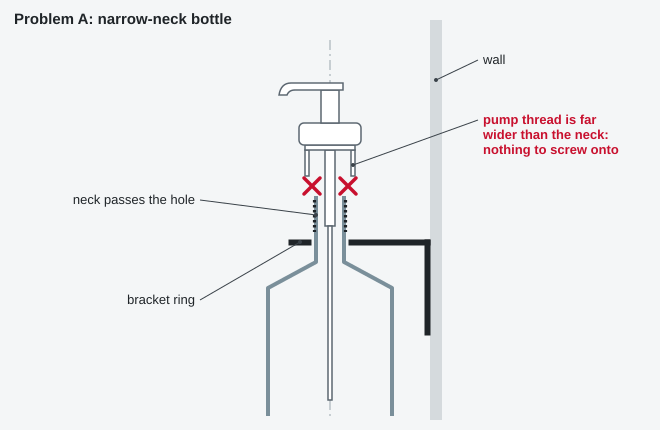
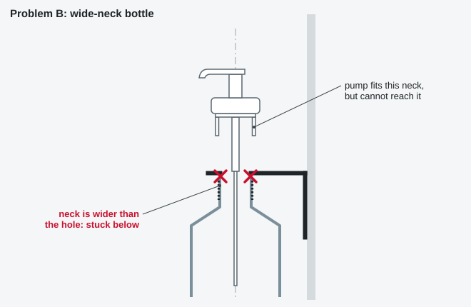
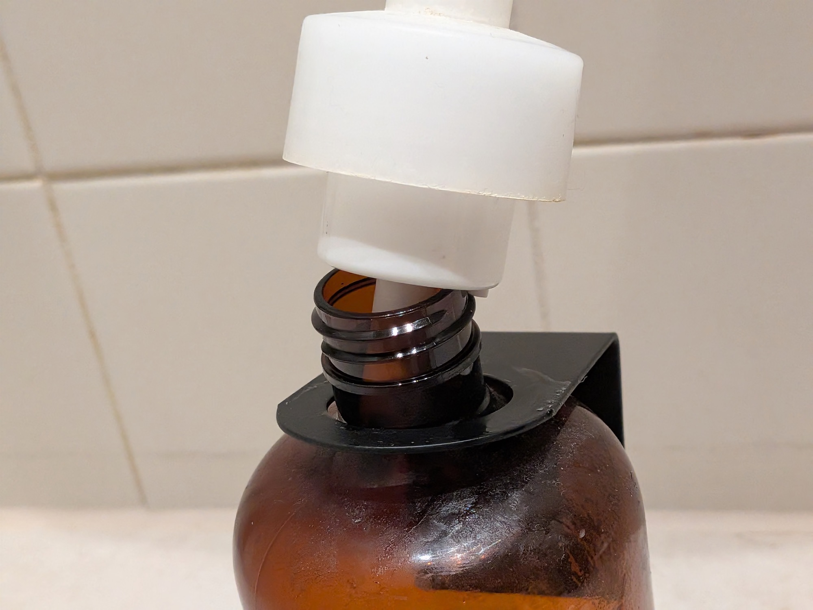
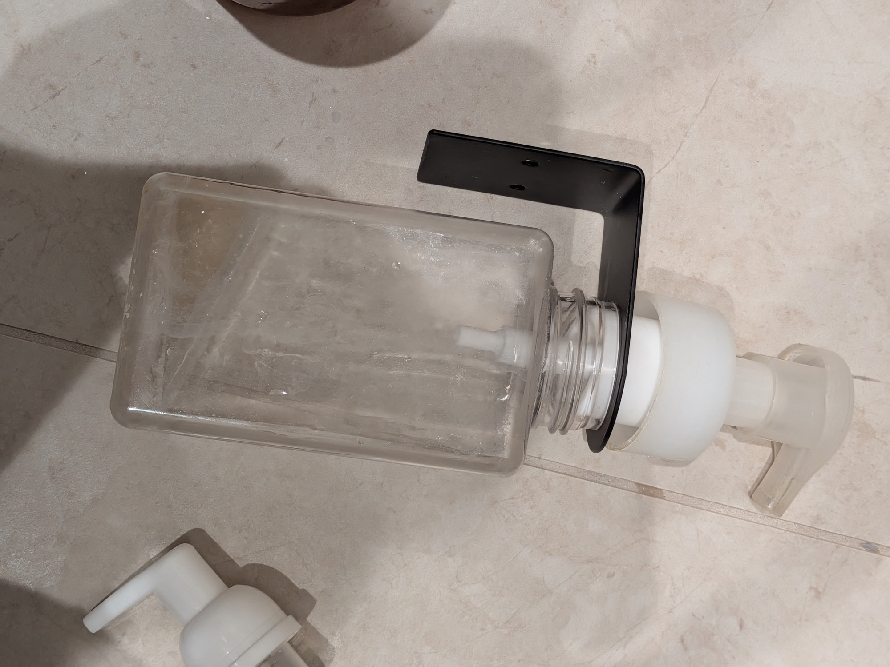
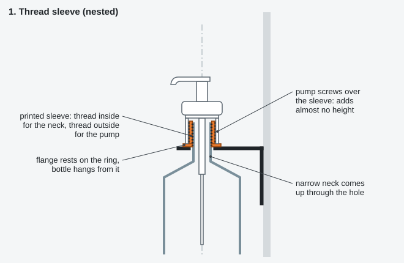
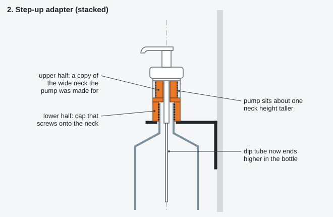
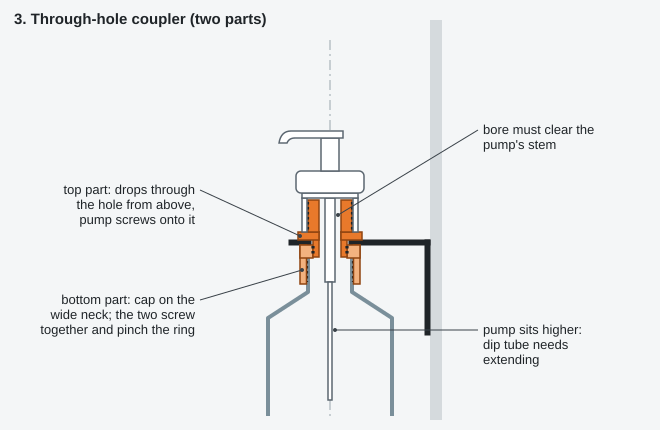
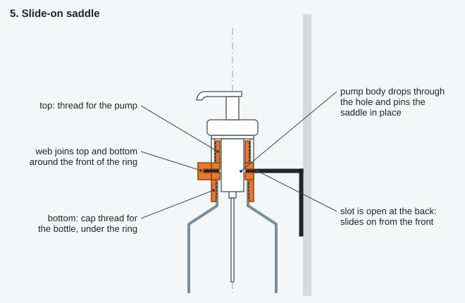
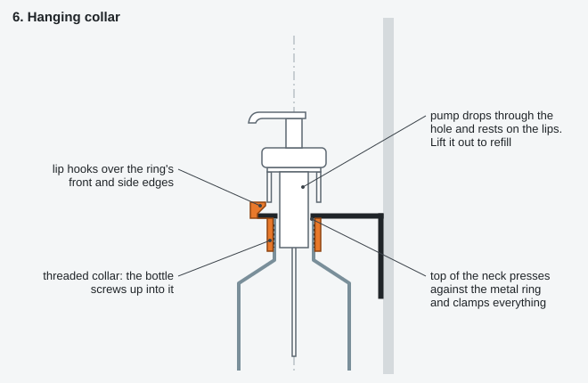
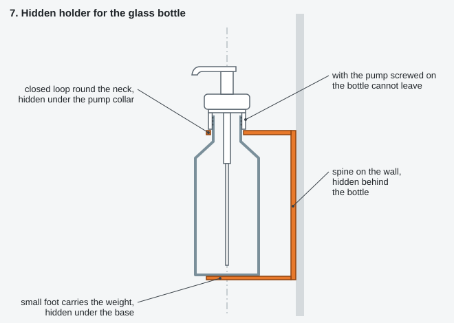

# Concepts

Sketches are schematic sections, **not to scale**: nothing is measured yet (`inventory/to-measure.md`).
Orange is printed, black is the metal bracket, grey is the bottle, white is the pump.

## What the first measurements say (2026-11-19)

- The translucent-head pump's body is 31.45 mm wide below the collar; the brown neck's bore is 21.3 mm. It
  cannot go on the brown bottle: concepts 1 and 2 are out for that pump.
- The same body nearly fills the 32.7 mm bracket hole, so concept 3 as sketched has no room for its tube.
- The white pump's stem is 21.1 mm and should just enter the brown neck. White pump on brown bottle, with
  concept 1 or 2, is the route. Which of the two depends on the white pump's thread, not yet measured.

## The problem

| | |
|---|---|
|  |  |
|  |  |

The bottle hangs from whatever sits on top of the ring, so that thing must be wider than the hole, and the
neck must be narrower than it. Because the bottle hangs upright, the joint between pump and bottle never
sits in liquid: a printed thread has to carry the weight, it does not have to be watertight.

## 1. Thread sleeve (nested) — first choice if the numbers allow

One printed ring with a thread on the inside for the narrow neck and a thread on the outside for the pump,
plus a small flange that rests on the bracket.

- For: one small part, a few grams, prints without supports, hidden under the pump collar, adds almost no
  height so the dip tube (the pump's suction straw) still reaches the bottom.
- Against: only possible if the pump's thread is enough wider than the neck's to leave a printable wall
  between the two threads. Two printed threads to get right.
- Decided by: pump thread inner diameter minus narrow neck thread outer diameter, and whether the pump's
  stem fits down the narrow neck's bore.

## 2. Step-up adapter (stacked) — fallback for 1

A cap for the narrow neck with a copy of the wide neck on top of it.

- For: works whatever the two thread diameters are. Still one part.
- Against: the pump sits roughly one neck height taller and its dip tube ends that much higher, so the last
  of the soap stays in the bottle unless the tube is extended. More leverage on the bracket when pumping.
- Decided by: same stem-in-bore check as 1.

## 3. Through-hole coupler (two parts) — the way to keep the wide bottle

A bulkhead fitting (a fitting that passes through a panel and clamps it from both sides). The bottom part
is a cap on the wide neck, the top part drops through the hole, screws into it and carries the pump.

- For: the wide-neck bottle is the one the pump was made for. Pinching the ring also stops the bottle
  swinging.
- Against: two parts and three printed threads. The passage through the hole is the narrowest point and the
  pump stem must fit through it. The pump ends up well above the bottle, so the dip tube needs extending.
  Refilling means unscrewing under the bracket.

## 5. Slide-on saddle — for a wide pump on the wide bottle

Added 2026-11-19 for the third pump (52 mm collar, 32 mm body). Its body is too wide for the brown neck
(21.3 mm) but just passes the bracket hole (32.7 mm). One printed puck with a sideways slot slides onto the
ring from the front. It has a copy of the wide neck on top for the pump and a cap thread underneath for the
bottle. The pump's body drops through the hole into the bottle and so also pins the puck in place.

- For: one part, nothing has to squeeze through the hole except the pump itself. Works for the
  translucent-head pump too.
- Against: the pump sits roughly one neck height above the bottle's own neck, so the dip tube ends that much
  higher. The slot is a bridge (plastic printed across a gap) and may need the part split in two.
- The black pump's thread is wider than the clear bottle's, so the two threads differ: clear-neck thread
  below, black-pump thread on top. Checked 2026-11-19: the pump's 32 mm body passes the clear neck's
  33.75 mm bore.
- Still needed: the ring's outer width and sheet thickness, and the two thread pitches.

## 6. Hanging collar — chosen for the black pump on the clear bottle

Added 2026-11-19; replaces concept 5. A threaded collar sits under the ring and hooks over the ring's front
and side edges with lips. It slides on from the front. The bottle screws up into it until the top of its
neck presses against the underside of the metal ring, which clamps collar, ring and bottle together. The
pump is not screwed to anything: it drops through the hole into the bottle and rests on the lips.

- For: one part, one printed thread, no supports, about 14 cm³. Needs nothing measured on the pump except
  its body, which is done. The pump sits only about 6 mm higher than on its own bottle, so the dip tube
  still reaches. Refill by lifting the pump out and pouring through the hole. The thread takes up the
  difference between the two brackets' sheet thickness.
- Against: the pump can be lifted out by hand. The lips show at the front of the ring.
- CAD: `cad/hanging_collar.py`. Draft until the ring's front is measured and the thread has been printed.

## If the wall holder is ours to design too (2026-11-19, ideas only)

Without the 32.7 mm hole there is nothing to adapt: a bottle and the pump made for it screw together as
intended and the holder is shaped around them.

- **A. Fork holder.** A wall plate with an arm that ends in an open-fronted slot as wide as the bottle's
  neck. The bottle slides in from the front and hangs by its pump collar in a shallow seat. No threads.
- **B. Ring holder.** The old bracket's shape with a hole of the right size. Simplest to draw, but the pump
  has to be unscrewed to take the bottle down.
- **C. Cup shelf.** A small shelf with a rim that the bottle stands in. Takes any bottle and pump, carries a
  heavy glass bottle from below, but is the bulkiest and most visible.
- **D. Threaded holder.** The hanging collar and the bracket as one printed part. Only worth it for the
  black pump on the clear bottle, which do not screw together.

Favoured for the amber glass body: C, the cup shelf, because glass should be carried from below and be
unable to fall out forwards. A (open fork) is withdrawn for glass: a knock from below or the side can slide
the bottle out of the slot. Needs the glass body's width and base shape, and the wall screw spacing of the
old bracket, none of which are measured.

## 7. Hidden holder for the glass bottle (own wall holder, sketch only)

Jacob wants the holder to show as little as possible, and the glass bottle must not be able to fall. One
printed piece with three features, each behind something: a spine on the wall behind the bottle, a small
foot under the base that carries the weight, and a closed loop round the neck under the pump collar.

- The bottle goes in without its pump: neck up into the loop at a tilt, base swung onto the foot. With the
  pump screwed on, the collar is wider than the loop and the bottle cannot leave. Refill by unscrewing the
  pump; the bottle stays put.
- From the front only the loop's thin edge under the collar and the foot's edge can show. From the side
  the spine and the two arms are visible.
- Needs, all unmeasured: glass body width, height from base to the underside of the pump collar, neck
  diameter, base shape, wall screw spacing.

## Not printing anything

Foaming pumps are also sold for the common narrow neck size. If one fits the brown bottle, it is the least
work. Measure the narrow neck first, then search for a foam pump in that size.

## Recommendation

Measure first (about ten minutes with calipers). Then: concept 1 if the wall between the threads is
printable and the stem fits the narrow bore; concept 2 if only the stem fits; concept 3 if the stem does not
fit the narrow neck at all, because then only the wide bottle can take this pump.
