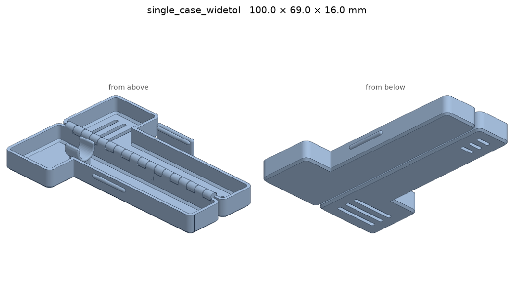
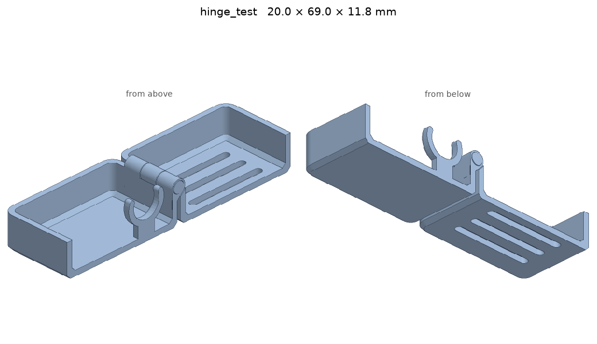

# Oral-B single brush head travel case


Owner: Jacob Ungar Felding. Started 2026-11-27. Designed, not printed yet.

A travel case for one Oral-B brush head (Vitality, Pro, Smart and the like; not iO or Pulsonic). It is a remix of
DrJones's print-in-place case, which comes in 2, 4 and 6-head sizes: I only travel with one head, so this is the
two-head case cut down to one (see [Credits](#credits-and-licence)). It prints in one piece, hinge and all.

What changed from the two-head case:

- **Stepped, not just narrower.** In the original the two heads lie head to tail with their bristles pointing
  sideways, into the room beside the other head's tube. So the bristle end keeps the full two-head width, up to
  just past the clip, where a copy of the original end wall closes it off. From there on only the tube lies in
  the case, and each half is one 15 mm lane narrower. The head gets exactly the room the original gives it, and
  no brush head had to be measured.
- **No stand pegs.** In the original they stand between the two heads when the case is shut. With one head there
  is nowhere for them to go, so this one is a travel case only.
- The far clip is gone. The kept clip, the hinge, the latch and the finger slot are untouched.

## Parts

| Picture | File | What |
|---|---|---|
|  | `exports/single_case.stl` | the case, DrJones's normal hinge clearance. 100 × 69 × 16 mm open, 14.5 cm³ |
|  | `exports/single_case_widetol.stl` | the same with DrJones's wider hinge clearance, for when the normal one fuses |
|  | `exports/hinge_test.stl` | the first 20 mm of the case: end wall and three hinge knuckles, normal clearance |
|  | `exports/hinge_test_widetol.stl` | the same, wide clearance |

The source is a mesh, so there are no STEP files.

## Printing

Print it open, flat as it comes, no supports, no brim: 0.4 mm nozzle, 0.2 mm layers (DrJones prints PLA on a
Prusa Mini). Print the two hinge tests first, a few grams each, and snap them open: whichever frees up cleanly
tells you which case to print.

## Build

```sh
./check.sh     # rebuilds exports/ from vendor/oralbox2/, checks the halves still close, checks the pictures
```

`cad/single_case.py` works on the original mesh:

1. Cut the far clip and both pegs off at the floor.
2. Make a narrow copy of each half: cut a 15 mm strip parallel to the hinge out of the floor and move the outer
   wall in.
3. Join them: the full half from the end wall to x = 26 (the clip ends at 26.5, the bristles sit before 18), a
   copy of the original's far end wall as the step at x 26–28, the narrow half from there on.

The positions are read from the original mesh and live in `cad/measurements.py`. `cad/check.py` folds the clip
half shut about the rim plane (z = 9.5 mm) and checks the halves overlap no more than the original's do: both are
2.53 mm³, the hinge knuckles meeting (`exports/checks.json`).

## Credits and licence

Remix of [Oral-B Electric 2/4/6 Toothbrush Head Travel Case and Stand (PIP)](https://www.printables.com/model/272148-oral-b-electric-246-toothbrush-head-travel-case-an)
by **DrJones**, licensed [CC BY 4.0](https://creativecommons.org/licenses/by/4.0/). Changed: the second clip and the
stand pegs removed, the case narrowed by one lane past the clip with the original end wall copied in as the step,
vent slots shortened; hinge test pieces cut from the result. The original files are in
[`vendor/oralbox2/`](vendor/oralbox2/) with their checksums.

All parts here are CC BY 4.0 too: credit DrJones and this project. The scripts are MIT, like the rest of the repo.
